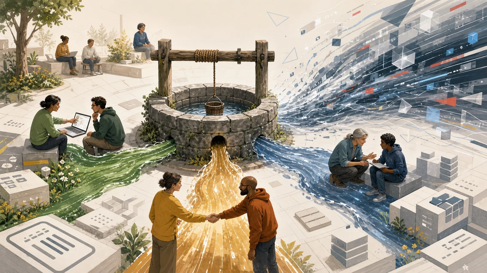
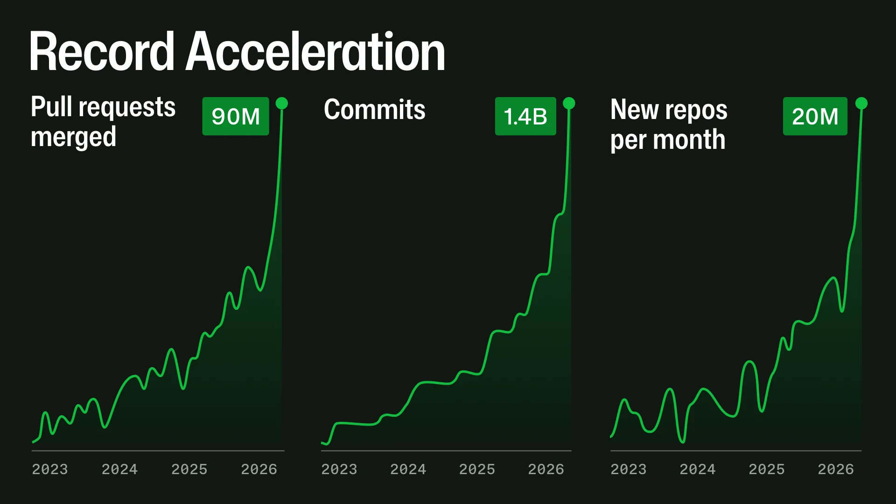
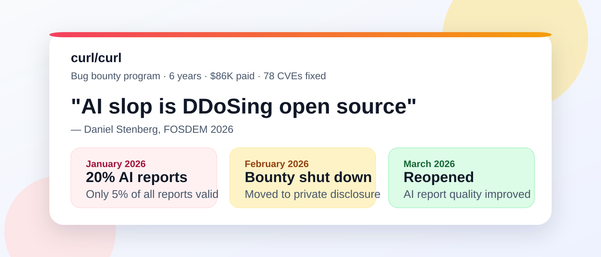
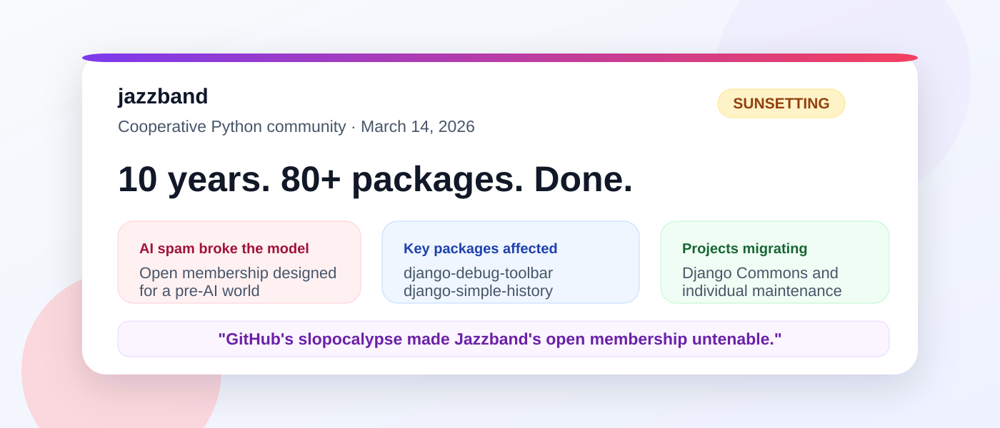
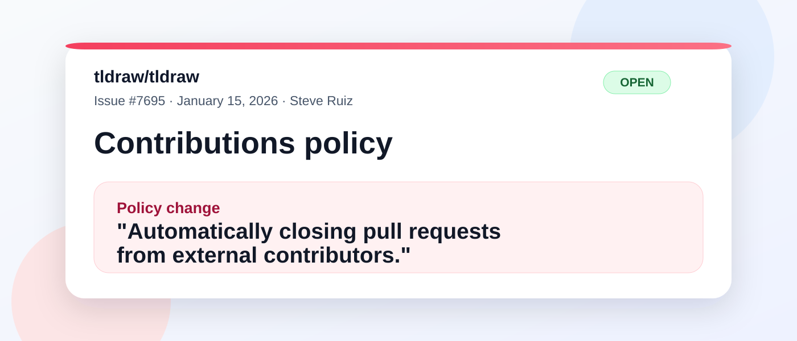
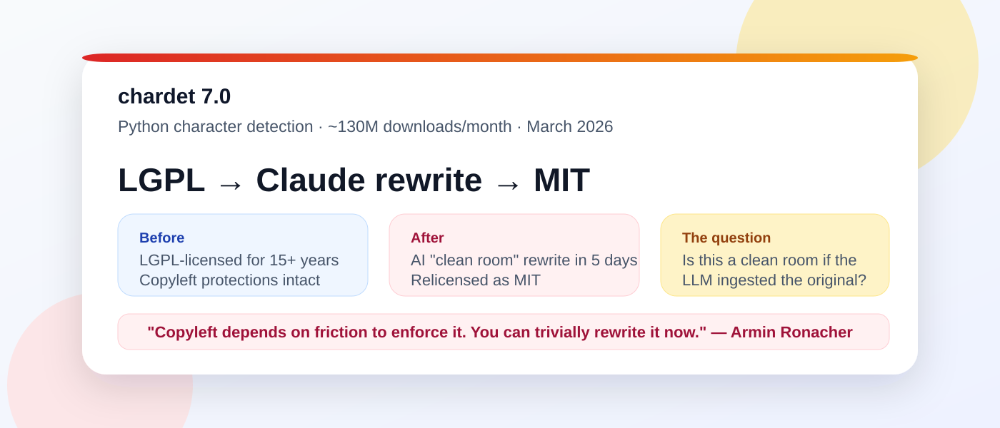
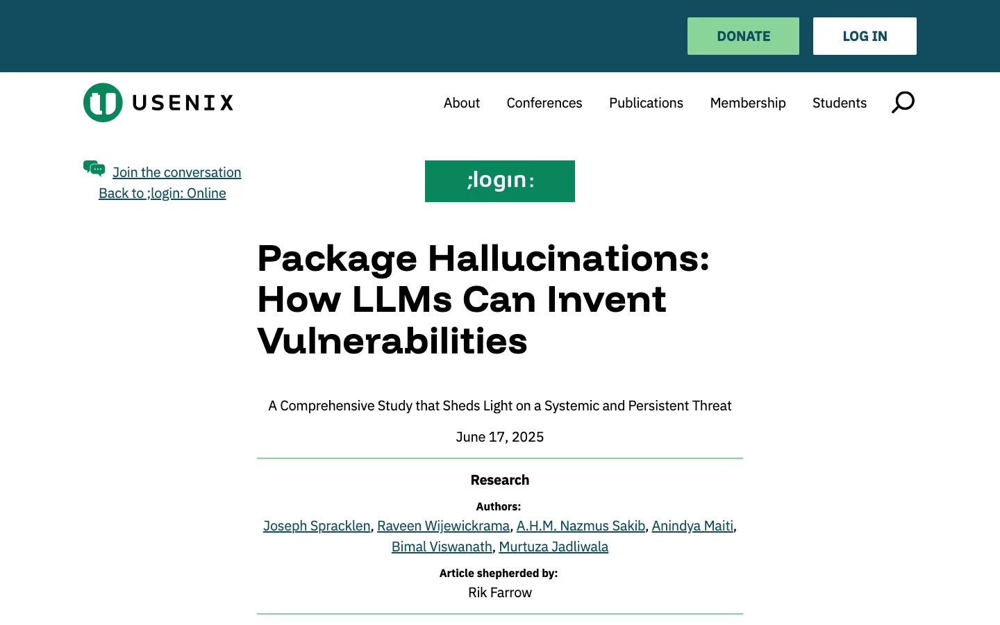
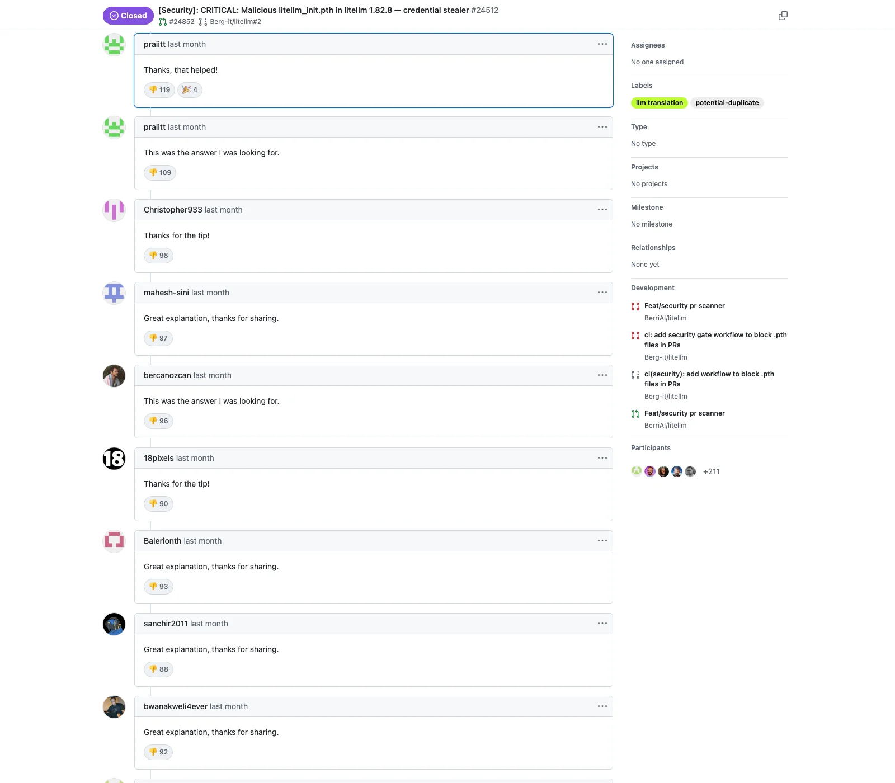
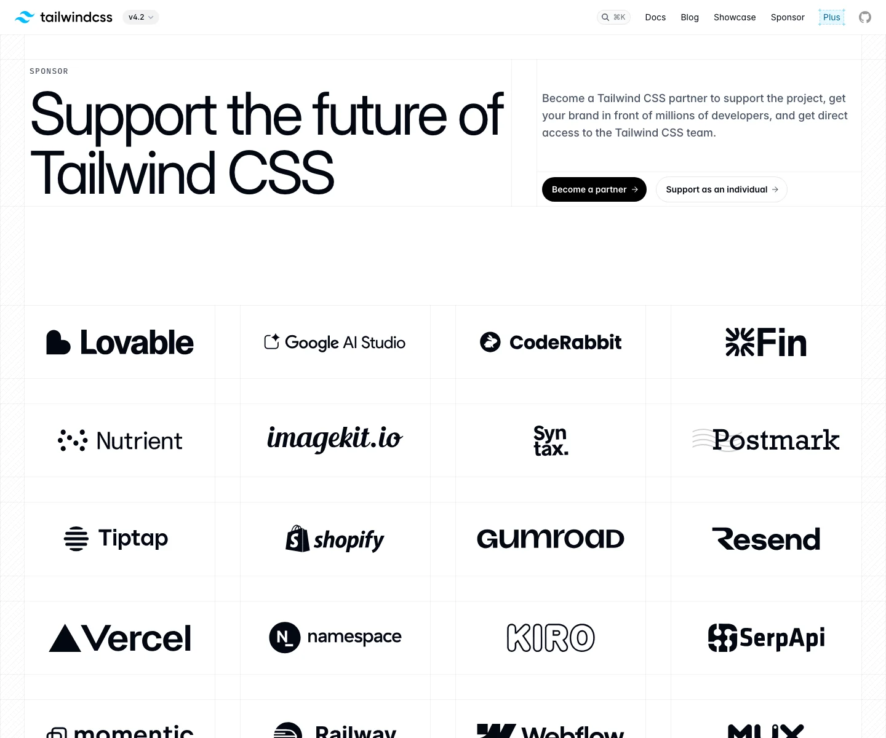
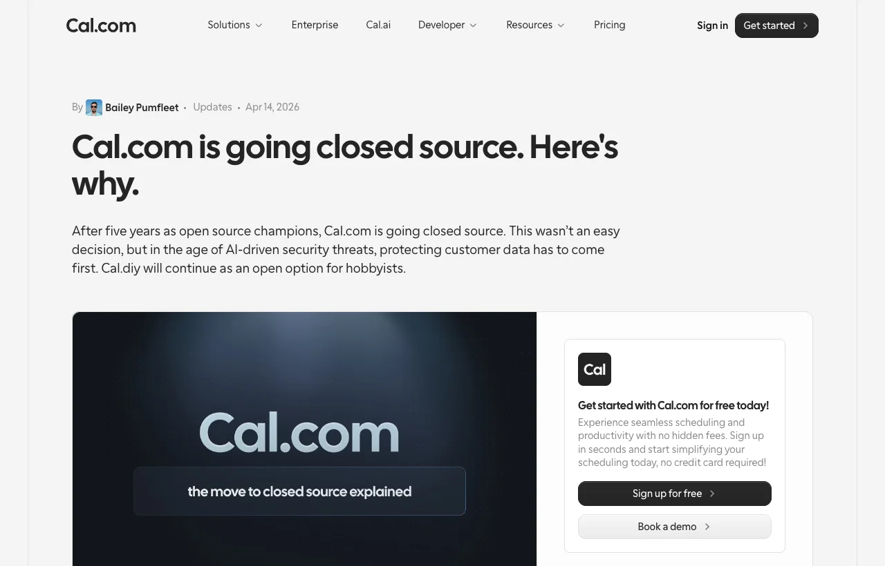

---
format:
  revealjs:
    css: style.css
    theme: simple
    revealjs-plugins:
      - a11y
    revealjs-a11y:
      # 0.2.3's menus introduce ARIA failures; retain our slide-menu handling.
      slide-menu-a11y: false
      menu: false
      # Use the extension's core accessibility fixes without extra UI/shortcuts.
      font-size-controls: false
      font-selection: false
      text-spacing: false
      transcript: false
      slide-change-cue: false
    slide-number: true
    code-line-numbers: false
    preview-links: auto
    keyboard: true
    touch: true
    help: true
    include-in-header: meta-tags.html
    include-after-body: accessibility.html
    link-external-newwindow: true
execute:
  echo: true
  eval: false
keywords: ["open-source", "foss", "ai", "software-security", "maintainers"]
description-meta: "A presentation about how AI-generated pull requests, new security attack surfaces, and collapsing trust are poisoning the FOSS movement."
license: "CC0 1.0 Universal"
pagetitle: "Poisoning the FOSS Well"
author-meta: "Indrajeet Patil"
date-meta: "2026-04-18"
lang: "en"
dir: "ltr"
image: "media/social-media-card.webp"
image-alt: "Preview image for presentation about AI poisoning the FOSS movement"
canonical-url: "https://www.indrapatil.com/ai-poisoned-foss-well/"
jupyter: python3
---
## Poisoning the FOSS Well {style="margin-top: 1.5em; margin-bottom: 1em;"}

:::: {.columns}

::: {.column width="56%"}

::: {style="margin-top: 1.5em; margin-bottom: 1em;"}

::: {style="font-size: 0.92em; font-weight: bold;"}
How AI is Poisoning the Free and Open Source Software Movement
:::

::: {style="font-size: 0.8em; margin-top: 1em;"}
Indrajeet Patil

::: {style="font-size: 0.85em; margin-top: 0.3em;"}
**[FOSS developer](https://www.indrapatil.com/experience/open-source/), 8+ years**

ZEISS FOSS CoP

24th June, 2026
:::
:::

:::

:::

::: {.column width="44%"}

{.hero width="310" height="430" fig-alt="An old water well in a grassy field"}

:::

::::

::: {style="text-align: center; font-size: 0.55em; margin-top: 1.4em; color: #666;"}
Photo: [Daniel Prado / Unsplash](https://unsplash.com/photos/old-wishing-well-in-a-grassy-field-with-trees-U08P3HTx3SI)
:::

::: {style="text-align: center; font-size: 0.6em; margin-top: 0.9em; color: #666;"}
Source code for these slides can be found [on `GitHub`](https://github.com/IndrajeetPatil/ai-poisoned-foss-well/){style="text-decoration: underline;"}.
:::

::: {.notes}
Good [morning/afternoon], everyone. My name is Indrajeet Patil. I've been building and maintaining FOSS for over eight years now — mostly in the R ecosystem, but the problems I want to talk about today cut across every language and every community.

The title of this talk is "Poisoning the FOSS Well" — and by "well," I don't just mean well as in "things are going well." I mean the actual communal resource. The shared well that the entire software industry draws from. And the thesis is straightforward: AI is putting real strain on the systems that keep that well clean.
:::
## The FOSS well {.smaller}

:::: {.columns}

::: {.column width="62%"}

{.illustration width="630" height="355" fig-alt="Generated illustration of an open-source commons as a stone well fed by review labour, trust, and reciprocity, with a synthetic digital current disturbing the system"}

:::

::: {.column width="38%"}

::: {style="background-color: #e3f2fd; padding: 13px; border-radius: 18px; margin-bottom: 9px; font-size: 0.7em;"}
**96%** of codebases include open-source software; **$8.8T** estimated global replacement value.

::: {style="font-size: 0.75em; margin-top: 12px; color: #444;"}
[Synopsys OSSRA / Harvard](https://d3.harvard.edu/revealing-value-the-economic-power-of-open-source-software/)
:::

:::

::: {style="background-color: #e8f5e9; padding: 16px; border-radius: 18px; font-size: 0.72em;"}
FOSS runs on three social inputs — **review labour**, **trust**, and **reciprocity**. LLMs put strain on all three at once.
:::

:::

::::

::: {style="background-color: #f8f9fa; border-left: 4px solid #007bff; padding: 10px 12px; font-size: 0.58em; margin-top: 0.65em; color: #444;"}
**Boundary:** Low-quality PRs and burnout predate LLMs. AI changes speed, volume, and plausibility; the underlying commons problem is still under-compensated maintainer labour.
:::

::: {.notes}
For this room, I don't need to argue that FOSS matters. Ninety-six percent of codebases include open-source components, and Harvard researchers have estimated the global replacement value of open-source software at around 8.8 trillion dollars. The point is not that FOSS is important — we know that. The point is that the maintenance model behind it is more fragile than its economic value suggests.

I want to frame that maintenance model around three social inputs: review labour, trust, and reciprocity. Review labour turns patches into shared infrastructure. Trust lets maintainers accept help from people they do not personally know. Reciprocity is the implicit exchange: you contribute upstream, you benefit downstream.

Large language models are putting pressure on all three of these at once. And I want to be clear up front about something: low-quality contributions and maintainer burnout are not new. They predate AI entirely. What AI changes is the speed, the volume, and — critically — the plausibility of the noise. The underlying problem is still that maintainer labour is chronically undercompensated. AI just made the maths worse.
:::
## Review labour {style="margin-top: 2.3em; text-align: left;"}

::: {style="text-align: left; font-size: 0.9em; color: #666; margin-top: 1.1em;"}
AI volume overwhelms the people who turn patches into shared infrastructure.
:::

::: {.notes}
So let's start with review labour — the most immediately visible pressure point. AI is generating volume that overwhelms the people who turn patches into shared infrastructure.
:::
## The flood in numbers {.smaller}

:::: {.columns}

::: {.column width="42%"}

```{=html}
<div class="flood-meter" role="img" aria-label="AI-generated pull request volume on GitHub: 17 million per month by March 2026, a 325 percent increase from September 2025, while maintainer numbers stayed flat.">
  <div class="flood-meter__headline">
    <span>17M</span>
    <strong>AI-generated PRs per month (March 2026)</strong>
  </div>
  <div class="flood-stat flood-stat--red">
    <strong>325%</strong>
    <span>increase in six months — up from 4M in September 2025</span>
  </div>
  <div class="flood-stat flood-stat--amber">
    <strong>~4.5%</strong>
    <span>of all public <code>GitHub</code> commits from <code>Claude Code</code> alone</span>
  </div>
  <div class="flood-stat flood-stat--green">
    <strong>Flat</strong>
    <span>number of people taking on maintainer or ownership roles</span>
  </div>
  <div class="flood-meter__footer">"A denial-of-service attack on human attention." — <code>GitHub</code>, What to expect for open source in 2026</div>
</div>
```

:::

::: {.column width="58%"}

{.artifact width="610" height="340" fig-alt="GitHub blog figure showing record acceleration of pull requests merged, commits, and new repositories per month"}

::: {style="background-color: #ffebee; padding: 14px; border-radius: 18px; margin-top: 12px; margin-bottom: 10px; font-size: 0.76em;"}
**AI PR quality is still a review burden.** `CodeRabbit` reports AI-generated PRs carry 1.7x more issues than human-written ones.
:::

:::

::::

::: {style="text-align: center; font-size: 0.38em; margin-top: 0.5em; color: #666;"}
Sources: [`GitHub` AI Agent Problem](https://www.danilchenko.dev/posts/2026-04-11-github-ai-agents-pull-requests/) · [`GitHub`, open source in 2026](https://github.blog/open-source/maintainers/what-to-expect-for-open-source-in-2026/) · [CodeRabbit](https://www.coderabbit.ai/blog/ai-is-burning-out-the-people-who-keep-open-source-alive)
:::

::: {.notes}
Here are the numbers. By March 2026, GitHub was seeing roughly 17 million AI-generated pull requests per month. That's a 325 percent increase in just six months — up from about 4 million in September 2025. Claude Code alone now accounts for around four and a half percent of all public GitHub commits.

And while the PR volume exploded, the number of people stepping into maintainer or ownership roles stayed flat. GitHub themselves called this a "denial-of-service attack on human attention," and I think that framing is exactly right.

It's also not just about quantity. CodeRabbit's data shows that AI-generated PRs carry about 1.7 times more issues than human-written ones. So not only are there more PRs to review — each one takes more effort to evaluate.
:::
## Pollution of Pull Requests {.smaller}

:::: {.columns}

::: {.column width="39%"}

::: {style="background-color: #ffebee; padding: 16px; border-radius: 18px; margin-bottom: 16px;"}

::: {style="font-size: 1.15em; font-weight: bold; margin-bottom: 8px;"}
Cheap to submit.<br>
Expensive to review.
:::

- Plausible diff
- No context
- No ownership after feedback

:::

::: {style="background-color: #e3f2fd; padding: 16px; border-radius: 18px; font-size: 0.78em;"}
**Public example, February 2026**<br>
`Matplotlib` maintainer **Scott Shambaugh** rejected an AI-authored change. Hours later, an AI persona published a personal attack piece about him.
:::

:::

::: {.column width="61%"}

{.artifact width="620" height="500" fig-alt="Screenshot of Scott Shambaugh's post about an AI agent publishing a hit piece after a rejected pull request"}

:::

::::

::: {style="text-align: center; font-size: 0.55em; margin-top: 0.8em; color: #666;"}
Source: [Scott Shambaugh, "An AI Agent Published a Hit Piece on Me"](https://theshamblog.com/an-ai-agent-published-a-hit-piece-on-me/)
:::

::: {.notes}
This gets to the core asymmetry: AI-generated contributions are cheap to submit and expensive to review. They produce a plausible-looking diff, but they often come with no context, no understanding of the project's goals, and — importantly — no ownership after feedback. The person who submitted the PR vanishes once you leave a review comment.

There's a vivid example from February 2026. Scott Shambaugh, a Matplotlib maintainer, rejected an AI-authored pull request. Hours later, an AI persona published a personal attack article about him online. That's a scenario none of us anticipated. Not just low-quality contributions, but automated retaliation against maintainers for doing their jobs.
:::
## When the bounty backfires {.smaller}

:::: {.columns}

::: {.column width="65%"}

{.artifact width="750" height="420" fig-alt="Stylized evidence card showing curl's bug bounty shutdown in February 2026 after AI slop overwhelmed the security team, and its reopening in March after AI quality improved"}

:::

::: {.column width="35%"}

::: {style="background-color: #ffebee; padding: 16px; border-radius: 18px; font-size: 0.8em;"}
**Seven fake reports in 16 hours**<br>
Each one plausible enough to demand triage — the real cost is maintainer attention, not the reports themselves.
:::

:::

::::

::: {style="text-align: center; font-size: 0.48em; margin-top: 0.7em; color: #666;"}
Sources: [The Register](https://www.theregister.com/2026/01/21/curl_ends_bug_bounty/) · [The New Stack](https://thenewstack.io/drowning-in-ai-slop-reports-curl-ends-bug-bounties/) · [Daniel Stenberg, FOSDEM 2026](https://thenewstack.io/curls-daniel-stenberg-ai-is-ddosing-open-source-and-fixing-its-bugs/)
:::

::: {.notes}
The review burden extends to security too. In January 2026, curl — one of the most critical pieces of software on the planet — shut down its bug bounty programme. Daniel Stenberg's team received seven fabricated security reports in sixteen hours. Each one was plausible enough to demand triage. The reports weren't dangerous in themselves — the real cost was the maintainer attention they burned.

The good news, which we'll return to later, is that curl reopened the bounty in March after AI report quality improved. But the signal is clear: when the noise becomes indistinguishable from the signal, even well-funded security programmes break down.
:::
## Shared maintenance breaks first {.smaller}

:::: {.columns}

::: {.column width="65%"}

{.artifact width="750" height="420" fig-alt="Stylized evidence card showing Jazzband's March 2026 sunsetting after AI spam made its open-membership model untenable"}

:::

::: {.column width="35%"}

::: {style="background-color: #e3f2fd; padding: 16px; border-radius: 18px; margin-bottom: 14px; font-size: 0.78em;"}
**Before:** Anyone could join, triage issues, and merge PRs across 80+ packages. Shared trust scaled maintenance without centralised control.
:::

::: {style="background-color: #ffebee; padding: 16px; border-radius: 18px; font-size: 0.78em;"}
**After:** AI spam made open membership a liability. `Django` projects have `Django Commons`; non-`Django` packages must find new homes or risk going unmaintained.
:::

:::

::::

::: {style="text-align: center; font-size: 0.48em; margin-top: 0.7em; color: #666;"}
Sources: [`Jazzband` sunsetting announcement](https://jazzband.co/news/2026/03/14/sunsetting-jazzband) · [`Jazzband` wind-down plan](https://jazzband.co/news/2026/03/14/wind-down-plan)
:::

::: {.notes}
And when security triage breaks, the most fragile structures are next. Jazzband was a community collective that maintained over 80 Python packages under a shared-membership model. The model depended on exactly the kind of open, distributed trust that many of us value in FOSS: low barriers, shared stewardship, and lightweight governance. AI spam made that openness a liability.

In March 2026, Jazzband announced it was sunsetting. Django-specific projects have Django Commons to fall back on. But the non-Django packages? They need to find new homes or risk going unmaintained. This is what it looks like when a working governance model becomes collateral damage.
:::
## Narrower funnels {.smaller}

:::: {.columns}

::: {.column width="65%"}

{.artifact width="750" height="420" fig-alt="Stylized snapshot of tldraw's January 2026 issue announcing automatic closure of pull requests from external contributors"}

:::

::: {.column width="35%"}

::: {style="background-color: #e3f2fd; padding: 16px; border-radius: 18px; margin-bottom: 14px; font-size: 0.78em;"}
Issues, bug reports, and discussions stayed open. What narrowed was the expensive part: reviewable code.
:::

::: {style="background-color: #e8f5e9; padding: 16px; border-radius: 18px; font-size: 0.76em;"}
**`Ghostty`** went further: first-time contributors now need a [maintainer vouch](https://github.com/mitchellh/vouch) before a PR stays open.
:::

:::

::::

::: {style="text-align: center; font-size: 0.5em; margin-top: 0.7em; color: #666;"}
Source: [`tldraw` issue #7695, "Contributions policy"](https://github.com/tldraw/tldraw/issues/7695)
:::

::: {style="background-color: #f8f9fa; border-left: 4px solid #007bff; padding: 10px 12px; font-size: 0.58em; margin-top: 0.65em; color: #444;"}
**Not all bans:** A [scan of 1,000 popular repositories](https://arxiv.org/abs/2605.16706) found 118 AI contribution policies — 78% allow GenAI but require disclosure and human review. The emerging norm is accountability, not prohibition.
:::

::: {.notes}
So projects are responding. And the responses are rational, but they carry costs.

tldraw, the collaborative whiteboard library, started automatically closing pull requests from external contributors. They kept issues, bug reports, and discussions open — what narrowed was the expensive part: reviewable code from strangers.

Ghostty went further. First-time contributors now need a maintainer vouch before their PR even stays open. These aren't overreactions — after what we've just seen with curl and Jazzband, they're survival mechanisms. But the emerging norm is worth noting: a scan of a thousand popular repositories found 118 AI contribution policies, and 78 percent of them do allow AI-generated code — they just require disclosure and human review. The standard isn't prohibition. It's accountability.
:::
## Who pays {.smaller}

```{=html}
<div class="cost-stack" role="img" aria-label="Impact map showing costs shifted onto junior developers, maintainers, projects, and the broader movement.">
  <div class="cost-stack__grid">
    <div class="cost-impact cost-impact--junior fragment" data-fragment-index="1">
      <em>Entry path narrows</em>
      <strong>Junior developers</strong>
      <span>lose first reviews, apprenticeship, and a low-friction route into FOSS.</span>
    </div>
    <div class="cost-impact cost-impact--maintainers fragment" data-fragment-index="2">
      <em>Attention fragments</em>
      <strong>Maintainers</strong>
      <span>carry suspicion, context switching, and unpaid incident response.</span>
    </div>
    <div class="cost-impact cost-impact--projects fragment" data-fragment-index="3">
      <em>Contribution base shrinks</em>
      <strong>Projects</strong>
      <span>lose diverse small contributions and become more closed and fragile.</span>
    </div>
    <div class="cost-impact cost-impact--movement fragment" data-fragment-index="4">
      <em>Renewal slows</em>
      <strong>The movement</strong>
      <span>loses the renewal mechanism that kept FOSS broad and resilient.</span>
    </div>
  </div>
</div>
```

::: {style="text-align: center; font-size: 0.48em; margin-top: 0.75em; color: #666;"}
Source: [Mara Averick, stdlib, 2026](https://blog.stdlib.io/ai-and-the-invisible-newcomer-in-open-source/)
:::

::: {.notes}
So who actually bears the cost? It cascades through the ecosystem.

Newcomers lose their entry path. First reviews, apprenticeship, that low-friction route into open source — those gates are closing. Maintainers carry more suspicion, more context-switching, and more unpaid incident response. Projects lose the diverse, small contributions that kept them broad and healthy. And the movement as a whole loses the renewal mechanism that has kept FOSS resilient for decades.

If you want to understand why this matters beyond the code itself, think about it as a pipeline problem. The people who will maintain the critical infrastructure of 2035 are the newcomers of today. Narrow the funnel now, and you pay for it later.
:::
## Trust {style="margin-top: 2.3em; text-align: left;"}

::: {style="text-align: left; font-size: 0.9em; color: #666; margin-top: 1.1em;"}
AI erodes the good-faith signals contributors and maintainers rely on.
:::

::: {.notes}
That brings us to the second pillar: trust. AI is eroding the good-faith signals that contributors and maintainers have always relied on.
:::
## AI amplifies the trust collapse {.smaller}

:::: {.columns}

::: {.column width="58%"}

```{=html}
<div style="background: #ffffff; border: 1px solid #e5e7eb; border-radius: 22px; padding: 10px; box-shadow: 0 18px 40px rgba(15, 23, 42, 0.1);">
  <iframe
    src="https://www.youtube.com/embed/aoag03mSuXQ"
    title="Veritasium video about the XZ Utils backdoor"
    loading="lazy"
    allow="accelerometer; autoplay; clipboard-write; encrypted-media; gyroscope; picture-in-picture; web-share"
    referrerpolicy="strict-origin-when-cross-origin"
    allowfullscreen
    style="width: 100%; height: 430px; border: 0; border-radius: 16px;">
  </iframe>
  <p style="text-align: center; font-size: 0.55em; margin: 6px 0 0 0; color: #666;">
    <a href="https://www.youtube.com/watch?v=aoag03mSuXQ">Watch on YouTube</a> if the embed doesn't load.
  </p>
</div>
```

:::

::: {.column width="42%"}

::: {style="background-color: #fff3e0; padding: 16px; border-radius: 18px; margin-bottom: 12px; font-size: 0.8em;"}
**`XZ Utils` changed the baseline**<br>
The lesson was not "review newcomers less kindly." It was that trust itself can be weaponized.
:::

::: {style="background-color: #e3f2fd; padding: 16px; border-radius: 18px; font-size: 0.8em;"}
**AI flood changes the front door**<br>
When maintainers see more bot-shaped PRs, every unsolicited submission becomes costlier to parse and easier to distrust.
:::

:::

::::

::: {style="text-align: center; font-size: 0.5em; margin-top: 0.7em; color: #666;"}
Context: [Veritasium, "The Most Clever Attack in Computing History"](https://youtu.be/aoag03mSuXQ?si=QOQqGUBr49P5NnEf)
:::

::: {.notes}
Most of you will know the XZ Utils backdoor. If you want the full narrative arc, this Veritasium video is a useful reconstruction. The part that matters for this talk is narrower: a contributor spent years building trust in a critical compression library, then inserted a sophisticated backdoor that was nearly shipped in every major Linux distribution.

The lesson from XZ wasn't "be less kind to newcomers." It was that trust itself can be weaponised — that patient, long-term social engineering can compromise infrastructure that billions of devices depend on.

Now layer AI on top of that. When maintainers see more bot-shaped pull requests, every unsolicited submission becomes costlier to evaluate and easier to distrust. The XZ attack changed the baseline. The AI flood changes the front door. Both push in the same direction: trust is getting more expensive to extend.
:::
## When code has no paper trail {.smaller}

:::: {.columns}

::: {.column width="65%"}

{.artifact width="750" height="420" fig-alt="Stylized evidence card showing chardet's AI-assisted relicensing from LGPL to MIT via Claude rewrite"}

:::

::: {.column width="35%"}

::: {.fragment fragment-index=1 style="background-color: #ffebee; padding: 16px; border-radius: 18px; margin-bottom: 14px; font-size: 0.78em;"}
**Licence laundering.**<br>
AI can regenerate copyleft code into a permissive project — no verbatim copy, but the original terms may still apply.
:::

::: {.fragment fragment-index=2 style="background-color: #e3f2fd; padding: 16px; border-radius: 18px; margin-bottom: 14px; font-size: 0.78em;"}
**Provenance black box.**<br>
An LLM cannot say where its output came from. Audits that used to trace imports now hit a dead end.
:::

::: {.fragment fragment-index=3 style="background-color: #fff3e0; padding: 16px; border-radius: 18px; font-size: 0.78em;"}
**Regulated sectors feel it first:** medical devices, automotive, and defence already require full provenance.
:::

:::

::::

::: {style="text-align: center; font-size: 0.46em; margin-top: 0.5em; color: #666;"}
Sources: [The Register, "AI will kill software licensing"](https://www.theregister.com/2026/03/06/ai_kills_software_licensing/) · [Black Duck OSSRA 2026](https://www.blackduck.com/resources/analyst-reports/open-source-security-risk-analysis.html) · [FDA SBOM guidance](https://www.fda.gov/medical-devices/digital-health-center-excellence/cybersecurity) · [EU CRA SBOM requirements](https://anchore.com/sbom/eu-cra/)
:::

::: {.notes}
There's a subtler trust problem: provenance. Consider what happened with chardet, a character-detection library. The original was licensed under LGPL — a copyleft licence. Someone used Claude to rewrite it and released the result under MIT, a permissive licence. No verbatim copying, so no obvious infringement. But the original licence terms may still apply.

This is what I'd call "licence laundering." An LLM can regenerate copyleft code into something that looks original. And because the model can't tell you where its output came from, audits that used to trace imports now hit a dead end. This matters most in regulated sectors — medical devices, automotive, defence — where full provenance isn't optional. It's legally required.
:::
## Hallucinations as supply-chain bait {.smaller}

:::: {.columns}

::: {.column width="38%"}

::: {style="background-color: #ffebee; padding: 14px; border-radius: 18px; margin-bottom: 12px; font-size: 0.76em;"}
**The package does not need to exist first.**<br>
The model can invent it. An attacker can register it later.
:::

::: {style="background-color: #e3f2fd; padding: 14px; border-radius: 16px; font-size: 0.7em; margin-top: 10px;"}
**5.2% vs 21.7%**<br>
Average package-hallucination rate for commercial versus open-weight models (2024).
:::

:::

::: {.column width="62%"}

{.artifact width="610" height="382" fig-alt="Screenshot of the USENIX article about comprehensive analysis of package hallucinations in code-generating LLMs"}

:::

::::

::: {style="text-align: center; font-size: 0.5em; margin-top: 0.6em; color: #666;"}
Sources: [USENIX ;login:, 2025](https://www.usenix.org/publications/loginonline/we-have-package-you-comprehensive-analysis-package-hallucinations-code) · [USENIX Security '25](https://www.usenix.org/system/files/usenixsecurity25-spracklen.pdf) · 205,474 phantom names observed
:::

::: {style="background-color: #f8f9fa; border-left: 4px solid #007bff; padding: 10px 12px; font-size: 0.58em; margin-top: 0.65em; color: #444;"}
**Trend vs. floor:** Newer models hallucinate fewer packages, but [Kalai (OpenAI, 2024)](https://arxiv.org/abs/2311.14648) proved that calibrated language models have an irreducible hallucination rate — the floor is above zero by design, not just by current limitation.
:::

::: {.notes}
And when provenance breaks down, attackers don't even need real packages to exploit the gap. LLMs hallucinate package names. A 2024 study found over 205,000 phantom package names in generated code — packages that don't exist. The average hallucination rate was about 5 percent for commercial models and nearly 22 percent for open-weight models.

Here's the attack: the model invents a package name. A developer installs it without checking. An attacker registers that name on a package registry, pre-loaded with malicious code. The package doesn't need to exist first — the model creates the demand, and the attacker fills it.

Newer models are getting better at this, but there's a theoretical floor. Research from OpenAI showed that calibrated language models have an irreducible hallucination rate. The floor is above zero by design, not just by current limitation.
:::
## Security Exploitation {.smaller}

:::: {.columns}

::: {.column width="40%"}

::: {style="background-color: #ffebee; padding: 14px; border-radius: 18px; margin-bottom: 12px; font-size: 0.88em;"}
**Noise became part of the incident.**
:::

::: {style="background-color: #e3f2fd; padding: 14px; border-radius: 18px; margin-bottom: 12px; font-size: 0.84em;"}
**March 2026**<br>
`LiteLLM` issue `#24512` warned that the package on `PyPI` was compromised.
:::

::: {style="background-color: #fff3e0; padding: 14px; border-radius: 18px; font-size: 0.84em;"}
**Nearly 500 comments**<br>
The thread was submerged in repetitive bot-shaped replies.<br>
Briefly closed as `not_planned`, then reopened; a separate status thread stayed open.
:::

:::

::: {.column width="60%"}

{.artifact width="610" height="455" fig-alt="Screenshot of the LiteLLM security issue flooded with repetitive comments"}

:::

::::

::: {style="text-align: center; font-size: 0.55em; margin-top: 0.8em; color: #666;"}
Sources: [`LiteLLM` issue #24512](https://github.com/BerriAI/litellm/issues/24512) · [status thread #24518](https://github.com/BerriAI/litellm/issues/24518)
:::

::: {style="background-color: #f8f9fa; border-left: 4px solid #007bff; padding: 10px 12px; font-size: 0.58em; margin-top: 0.65em; color: #444;"}
**Broader trend:** `ReversingLabs` reports a **73%** increase in malicious OSS package detections in 2025, with `npm` accounting for nearly **90%** of detected open-source malware.
:::

::: {.notes}
And when real security incidents do happen, the noise makes response even harder. In March 2026, an issue was filed on LiteLLM warning that the package on PyPI had been compromised. Legitimate, serious, actionable. But the issue thread was flooded with nearly 500 repetitive, bot-shaped comments. The real discussion was submerged. The issue was briefly closed as "not planned" before being reopened.

This is the cumulative effect: trust eroded, provenance gone, phantom packages weaponized — and when a genuine compromise surfaces, the signal drowns in noise. ReversingLabs reported a 73 percent increase in malicious open-source package detections in 2025, with npm accounting for nearly 90 percent of the detected malware.
:::
## Reciprocity {style="margin-top: 2.3em; text-align: left;"}

::: {style="text-align: left; font-size: 0.9em; color: #666; margin-top: 1.1em;"}
AI breaks the implicit exchange that funds and sustains open-source work.
:::

::: {.notes}
The third pillar: reciprocity. The implicit exchange that funds and sustains open-source work.
:::
## The docs-led business-model shock {style="font-size: 0.74em;"}

:::: {.columns}

::: {.column width="42%"}

```{=html}
<div class="business-shock" role="img" aria-label="Docs-led business loop where framework adoption used to feed docs traffic and paid products, but AI-mediated answers weaken docs traffic and revenue.">
  <div class="business-shock__loop">
    <div class="loop-node">Free framework</div>
    <div class="loop-arrow">-></div>
    <div class="loop-node">Docs traffic</div>
    <div class="loop-arrow">-></div>
    <div class="loop-node">Paid wrappers<br>and sponsors</div>
  </div>
  <div class="business-shock__break">
    <strong>January 2026</strong>
    <span>Usage still rising</span>
    <span>Docs traffic about <b>40%</b> below early 2023</span>
    <span>Revenue close to <b>80%</b> lower</span>
    <span><b>75%</b> of engineers laid off</span>
  </div>
  <div class="business-shock__claim">Adoption rose. The docs-led business model cracked.</div>
</div>
```

:::

::: {.column width="58%"}

{.artifact width="562" height="348" fig-alt="Screenshot of Tailwind CSS sponsorship page asking companies to support the future of Tailwind CSS"}

:::

::::

::: {style="text-align: center; font-size: 0.38em; margin-top: 0.04em; color: #666;"}
Sources: [Adam Wathan on PR #2388](https://github.com/tailwindlabs/tailwindcss.com/pull/2388#issuecomment-3717222957) · [`Tailwind` Sponsor](https://tailwindcss.com/sponsor) · [`Tailwind` Plus](https://tailwindcss.com/plus)
:::

::: {style="background-color: #f8f9fa; border-left: 4px solid #007bff; padding: 12px; font-size: 0.6em; margin-top: 1em; color: #444;"}
**Causation vs. correlation:** `Tailwind`'s traffic drop could also stem from AI-powered search, market saturation, or competitors. AI isn't necessarily the sole driver.
:::

::: {.notes}
Here's a case study that really brings this home. Tailwind CSS is familiar enough that I don't need to explain the framework. What's relevant is the business loop around it: build a great free framework, drive traffic to the documentation, and monetise through paid products and sponsorships.

By January 2026, framework usage was still rising. But documentation traffic had dropped about 40 percent compared to early 2023, revenue was down nearly 80 percent, and 75 percent of the engineering team had been laid off. People were still using Tailwind — they just weren't visiting the docs anymore. AI tools were answering their questions instead.

Now, I want to be careful here. The traffic drop could also stem from AI-powered search more broadly, market saturation, or competitors. AI isn't necessarily the sole cause. But the pattern is real: when the intermediary between user and documentation is an AI model, the economics of docs-led open source break down.
:::
## Open source as a liability {style="font-size: 0.8em;"}

:::: {.columns}

::: {.column width="58%"}

```{=html}
<div style="background: #ffffff; border: 1px solid #e5e7eb; border-radius: 22px; padding: 10px; box-shadow: 0 18px 40px rgba(15, 23, 42, 0.1);">
  
</div>
```

:::

::: {.column width="42%"}

::: {style="background-color: #ffebee; padding: 16px; border-radius: 18px; margin-bottom: 12px; font-size: 0.82em;"}
**Actual move: `Cal.com`**<br>
In April 2026 the scheduling SaaS went closed source after five years in public.
:::

::: {style="background-color: #e3f2fd; padding: 16px; border-radius: 18px; font-size: 0.82em;"}
**Security rationale**<br>
The company said AI can scan public code for vulnerabilities and turn transparency into customer-data exposure.
:::

:::

::::

::: {style="text-align: center; font-size: 0.46em; margin-top: 0.7em; color: #666;"}
Sources: [`Cal.com` closed-source announcement](https://cal.com/blog/cal-com-goes-closed-source-why)
:::

::: {.notes}
Some companies are drawing a more drastic conclusion. In April 2026, Cal.com — a scheduling SaaS that had been open source for five years — went closed source. Their stated reason was security: they argued that AI can now scan public code for vulnerabilities and turn the transparency that open source provides into a customer-data exposure risk.

Whether you agree with their reasoning or not, the decision reflects a real shift in how some companies are weighing the costs and benefits of developing in the open.
:::
## Room for hope {style="margin-top: 2.3em; text-align: left;"}

::: {style="text-align: left; font-size: 0.9em; color: #666; margin-top: 1.1em;"}
The costs are real. So are the responses.
:::

::: {.notes}
So the picture is grim. But it's not hopeless. The costs are real — and so are the responses.
:::
## Useful AI gives stewardship time back {.smaller}

:::: {.columns}

::: {.column width="50%"}

::: {.fragment fragment-index=1 style="background-color: #e3f2fd; padding: 16px; border-radius: 18px; margin-bottom: 12px;"}

::: {style="font-size: 1.1em; font-weight: bold; margin-bottom: 8px;"}
+5.9% OSS contributions
:::

`Copilot` use was associated with higher code contributions, even as coordination time also rose (2024 study).

:::

::: {.fragment fragment-index=2 style="background-color: #e8f5e9; padding: 16px; border-radius: 18px; margin-bottom: 12px; font-size: 0.88em;"}

::: {style="font-size: 1.05em; font-weight: bold; margin-bottom: 8px;"}
curl bounty came back
:::

After shutting down in February, `curl` reopened on HackerOne in March 2026 — AI report quality had improved enough to make the programme viable again.

:::

::: {.fragment fragment-index=3 style="background-color: #fff3e0; padding: 16px; border-radius: 18px; font-size: 0.86em;"}

::: {style="font-size: 1.05em; font-weight: bold; margin-bottom: 8px;"}
Accountable reports work
:::

`Ghostty` accepted transparent AI-assisted reports that helped fix four real crashes.

:::

:::

::: {.column width="50%"}

::: {.fragment fragment-index=4 style="background-color: #e3f2fd; padding: 16px; border-radius: 18px; margin-bottom: 12px; font-size: 0.88em;"}

::: {style="font-size: 1.05em; font-weight: bold; margin-bottom: 8px;"}
AI finds real vulnerabilities
:::

Anthropic's Mythos, run via Linux Foundation Alpha Omega, reviewed `curl`'s source and flagged five potential vulnerabilities. One was confirmed real.

:::

::: {.fragment fragment-index=5 style="background-color: #e8f5e9; padding: 16px; border-radius: 18px; margin-bottom: 12px; font-size: 0.88em;"}

::: {style="font-size: 1.05em; font-weight: bold; margin-bottom: 8px;"}
Triage relief
:::

First-pass issue sorting with `Copilot SDK` can make maintainership more sustainable by filtering noise before it reaches human reviewers.

:::

::: {.fragment fragment-index=6 style="background-color: #FFFBC1; padding: 18px; border-radius: 25px; text-align: center;"}
The line is not AI versus no AI. It is whether the tool reduces stewardship burden or exports it to maintainers.
:::

:::

::::

::: {style="text-align: center; font-size: 0.46em; margin-top: 0.8em; color: #666;"}
Sources: [Song et al. (arXiv, 2024)](https://arxiv.org/abs/2410.02091) · [`GitHub` Blog, 2026](https://github.blog/ai-and-ml/github-copilot/building-ai-powered-github-issue-triage-with-the-copilot-sdk/) · [Continue Blog, 2026](https://web.archive.org/web/20260416234220/https://blog.continue.dev/were-losing-open-contribution) · [Cybernews on curl and Mythos](https://cybernews.com/security/curl-bug-bounty-ai-security-reports-daniel-stenberg/)
:::

::: {.notes}
Let me highlight some genuinely encouraging signals.

A 2024 study found that Copilot use was associated with a 5.9 percent increase in open-source code contributions. The curl bug bounty came back — AI report quality improved enough to make the programme viable again. Ghostty accepted transparent, AI-assisted bug reports that helped fix four real crashes. And Anthropic's Mythos tool, run through the Linux Foundation's Alpha Omega initiative, reviewed curl's source code and flagged five potential vulnerabilities — one of which was confirmed real.

On the triage side, tools like the Copilot SDK can do first-pass issue sorting, filtering noise before it reaches human reviewers. That kind of automation makes maintainership more sustainable, not less.

The line here is not AI versus no AI. It's whether the tool reduces stewardship burden or exports it to maintainers.
:::
## Conclusion {style="margin-top: 2.3em; text-align: left;"}

::: {style="text-align: left; font-size: 0.9em; color: #666; margin-top: 1.1em;"}
What it takes to keep the well drinkable.
:::

::: {.notes}
So where does this leave us? What does it take to keep the well drinkable?
:::
## Keep the well drinkable {.smaller}

```{=html}
<div class="well-two-column">
  <div class="well-action-rail" role="group" aria-label="Three guardrails keep the FOSS well drinkable: review time, provenance, and commons repair.">
    <div class="well-action well-action--review fragment" data-fragment-index="1">
      <strong>Maintainers: protect review time</strong>
      <span>Require AI disclosure · close synthetic drive-bys fast · demand follow-up ownership before merge</span>
    </div>
    <div class="well-action well-action--provenance fragment" data-fragment-index="2">
      <strong>Platforms: protect provenance</strong>
      <span>Ship attribution tooling · surface AI-provenance signals on PRs · fund forge alternatives and interoperability</span>
    </div>
    <div class="well-action well-action--commons fragment" data-fragment-index="3">
      <strong>Companies & funders: protect the commons</strong>
      <span>Verify dependencies you ship · fund maintainers upstream · keep a real entry path for newcomers</span>
    </div>
  </div>
  <div class="well-two-column__image">
    
  </div>
</div>
```

::: {style="background-color: #FFFBC1; padding: 14px 18px; border-radius: 25px; text-align: center; margin-top: 0.45em;"}
If openness becomes unaffordable, FOSS stops regenerating.
:::

::: {.notes}
I'll leave you with three guardrails that I think matter most.

First — maintainers, protect your review time. Require AI disclosure. Close synthetic drive-by PRs quickly. Demand follow-up ownership before you merge anything.

Second — platforms, protect provenance. Ship attribution tooling. Surface AI-provenance signals on pull requests. Fund alternatives and interoperability so the ecosystem isn't locked into a single forge.

Third — companies and funders, protect the commons. Verify the dependencies you ship. Fund maintainers upstream. And keep a real entry path for newcomers — because if you don't, the pipeline of future maintainers dries up.

The bottom line: if openness becomes unaffordable, FOSS stops regenerating. The well runs dry. And everyone who draws from it — virtually every modern software organisation — will feel it.
:::
# Thank You

Questions and critiques welcome.

<br>
<br>

::: {style="text-align: center; font-size: 0.7em;"}
Source code for these slides is available [on `GitHub`](https://github.com/IndrajeetPatil/ai-poisoned-foss-well/).
:::

::: {style="text-align: center; font-size: 0.7em; margin-top: 0.8em;"}
See more [slide decks](https://www.indrapatil.com/presentations/) on software engineering and open source.
:::

::: {style="text-align: center; font-size: 1em; margin-top: 1.1em;"}
<a class="deck-icon-link" href="https://www.linkedin.com/in/indrajeet-patil-ph-d-397865174/" aria-label="LinkedIn"><span class="deck-icon deck-icon-brands-linkedin" aria-hidden="true"></span></a>
&nbsp;&nbsp;
<a class="deck-icon-link" href="https://github.com/IndrajeetPatil" aria-label="GitHub"><span class="deck-icon deck-icon-brands-github" aria-hidden="true"></span></a>
&nbsp;&nbsp;
<a class="deck-icon-link" href="mailto:patilindrajeet.science@gmail.com" aria-label="Email"><span class="deck-icon deck-icon-solid-envelope" aria-hidden="true"></span></a>
:::

::: {.notes}
Thank you. The slides and source code are on GitHub. I'd love to hear your questions, pushback, and critiques.

---

## Notes for delivery

- **Audience calibration:** Assume the room already understands FOSS norms, contribution workflows, and why open source matters. Do not spend time defending FOSS as a concept; spend the time on what AI changes about review labour, trust, provenance, and reciprocity.
- **Pacing:** At ~22-25 minutes of speaking, you have comfortable margin for the 5-minute Q&A window. If running long, the easiest sections to compress are slides 6 (curl bounty) and 17 (Cal.com), since both are single-example illustrations.
- **Transitions:** The section divider slides (Review Labour, Trust, Reciprocity, Room for Hope, Conclusion) are natural pause points. Use them to take a breath, make eye contact, and reset the room's attention.
- **Tone calibration:** The talk presents hard evidence but ends constructively. Resist the temptation to editorialise beyond what the data shows — the slides already flag causation-vs-correlation caveats, and audiences respect that honesty.

---

## Anticipated Q&A

**"How do you actually enforce an AI disclosure policy?"**

The goal is not an automated detector, but establishing a clear community expectation. When a project asks for disclosure, it sets a cultural norm that honest contributors respect and gives maintainers clear mandate to decline unverified submissions.

**"What does a 'good' AI contribution actually look like?"**

The Ghostty example discussed earlier is a useful benchmark: contributors were transparent about using AI assistance, reported real issues, and remained engaged to address maintainer feedback. The core principle is accountability.

**"What can small projects do if they don't have large resources?"**

Low-overhead measures make a significant difference: clear contribution guidelines requiring disclosure, structured issue templates, and standard pull request review requirements before merging.

**"Aren't AI tools genuinely making developers more productive?"**

The presentation highlights productivity benefits in the Room for Hope section. The friction occurs when productivity gains for submitters shift disproportionate review burden onto maintainers without adequate verification.

**"Will AI eventually replace maintainers?"**

Maintenance is fundamentally a matter of judgment, context, and responsibility rather than sheer code throughput. The practical path forward is using automation for mechanical tasks while reserving human judgment for architecture, security, and project direction.
:::
